# ManageDigitalFiles
文件协作与共享平台 计算机毕业设计
所有源码均本人开发，项目是前后端分离的，所有的项目都具备了完整的业务逻辑，不仅仅局限于基础的增删改查（CRUD）操作，系统亮点众多。

本文注重于计算机毕业设计选题指导，列出题目均有源码， 大家可以去【公众号】(毕业终点站)获取或者加我【qq】(2112698948)提意见(别忘记Star哟)。备注：git

声明：仅用于学习使用，请勿用于任何商业行为！

1.系统非商用，非开源，非无偿。

2.由本人开发，如需源码，请联系以下方式，qq:2112698948。

3.项目有很多，并未全部上传，如果未找到想要的，可直接咨询。

# 电子文件管理与共享系统（文件协作与共享平台）

一套面向团队的资料管理平台：文件按组织、部门、节点分层存放，权限细化到「可查看 / 可下载 / 可编辑 / 可删除 / 可分享」五项；上传后自动留版本、算 MD5、抽摘要和关键词；对外分享可设提取码、有效期和访问次数；文章区按中文分词做内容推荐。用户网页端和平台管理后台两套界面，组织管理员在用户端里管本组织的部门和授权。

> 说明：下方先给系统亮点和技术选型，再按普通用户、平台管理员两块展示核心页面。文档展示 15 张截图，源文档另有视频、图片分类、在线工具、账号管理、登录日志等页面未逐一展开，功能在角色表里列全。

---

## 一、系统亮点

**① DeepSeek 智能检索**
把「找出去年所有的财务报告」这类自然语言交给 LangChain4j 解析成文件类型、时间范围、关键词等筛选条件，再叠加组织和节点权限过滤结果，不用在一排下拉框里逐项点。搜索页给了五个示例问法：最近 3 天的 PDF、去年的财务报告、最近一个月的 Word、包含「合同」的文档、2023 年的图片。

**② AI 文档摘要**
定时任务读取支持格式的文件内容，调 DeepSeek 生成摘要与关键词，用户在文档列表和文件属性里直接看结论，不必逐个打开。词库和摘要结果都落库，重复访问不再重复消耗接口。

**③ LCS 版本差异算法**
对 Word 文档和 TXT、SQL 文本做段落级或行级对比，按最长公共子序列标出新增、删除和未变内容，对比结果可在线查看也能下载，核对修订版本时不用两个窗口来回扫。

**④ MD5 重复文件识别**
按文件 MD5 分组找重复资料，配合同一组内的清理操作减少堆积。文件版本表里 MD5 和 OSS 路径并排列出，同一个文件的不同版本、不同副本一眼能分清。

**⑤ HanLP 中文分词**
文章内容先分词再做停用词过滤，剔掉标点和「的、了、是」这类无效词，留下真正用于内容匹配的词，避免推荐被语气词带偏。

**⑥ 余弦相似度推荐**
把文章转成词频向量，按夹角余弦排序取相近文章，在文章详情里做相关推荐，读完一篇能顺着找到同主题的资料。

**⑦ 组织部门权限协作**
组织下设部门树（乐乐的资源 → A 小组 / B 小组），文件节点按部门授权，权限级别从「完全控制」到只读分档，五项操作权限分开勾选，节点权限页支持批量设置和批量删除。

**⑧ 受控文件分享**
分享时可生成分享码、设提取密码、过期时间和访问次数上限；「我的分享」按卡片展示每个分享的访问次数、下载次数和剩余有效期，随时复制链接或取消分享；管理端能按分享码、状态、是否过期反查全部分享记录。

**⑨ ECharts 多维统计**
用户端六张指标卡（文件总数、文件夹总数、总存储空间、总下载、总查看、今日上传）配文件类型环图、上传趋势（按天 / 按周 / 按月切换）、上传与下载排行 TOP10；管理端另有文件大小分布（0–1MB 占 76.47%）和 24 小时操作活跃度。

**⑩ 文件存储与版本留痕**
上传可走本地磁盘或阿里云 OSS，版本表记录版本号、文件大小、MD5、OSS 存储路径和桶名称；最近访问里逐条记访问 IP、操作类型、访问时间和是否成功，谁在什么时候动了哪个文件都能查。

---

## 二、技术选型

| 层次 | 技术 |
| --- | --- |
| 架构 | B/S、MVC、前后端分离；用户网页端 + 管理后台，多角色与组织部门权限管理 |
| 后端 | Java 17、Spring Boot 3、Spring MVC、MyBatis-Plus、MySQL、JWT |
| 特色技术 | DeepSeek、LangChain4j、HanLP、Apache POI、PDFBox、阿里云 OSS |
| 前端 | Vue 3、Vite、Element Plus、Vue Router、Pinia、Axios、ECharts |
| 开发环境 | IDEA、JDK 17、Maven、MySQL、Node.js |

---

## 三、角色与功能

| 角色 | 主要功能 |
| --- | --- |
| 普通用户 | 注册登录与找回密码、文件上传与文件夹创建、重命名 / 移动 / 批量下载、图片视频文档分类浏览与预览、AI 自然语言搜索、文件摘要与关键词、历史版本与版本对比、文件分享（提取码 / 有效期 / 次数）、重复文件与空文件夹清理、垃圾箱恢复、文章浏览收藏点赞与相关推荐、文件数据可视化 |
| 组织管理员（组织内身份） | 组织空间维护与切换、成员加入申请审核、部门层级维护与成员管理、文件与文件夹权限配置、按部门批量设置查看 / 下载 / 编辑 / 删除 / 分享权限 |
| 平台管理员 | 用户账号管理、组织与成员管理、文件节点 / 分享 / 版本 / 节点权限管理、节点访问日志与分享日志、登录日志、文章分类与发布、推荐与显示状态、收藏点赞浏览记录、文件与文章统计分析 |

---

## 四、系统截图

> 源文档未提供独立的系统总览图，下方按普通用户、组织管理、平台管理员三块分区展示核心页面，首图为 AI 智能搜索页。

### 普通用户端

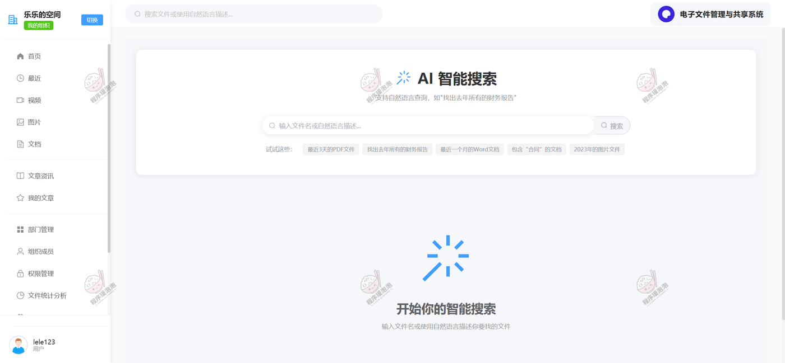

**AI 智能搜索**：顶部一个搜索框贯穿全站，点「AI 搜索」切到自然语言模式。中间区写「支持自然语言查询，如"找出去年所有的财务报告"」，下方列出五个示例问法；解析出来的条件会和当前用户的组织、节点权限一起参与过滤，搜不到没权限的文件。

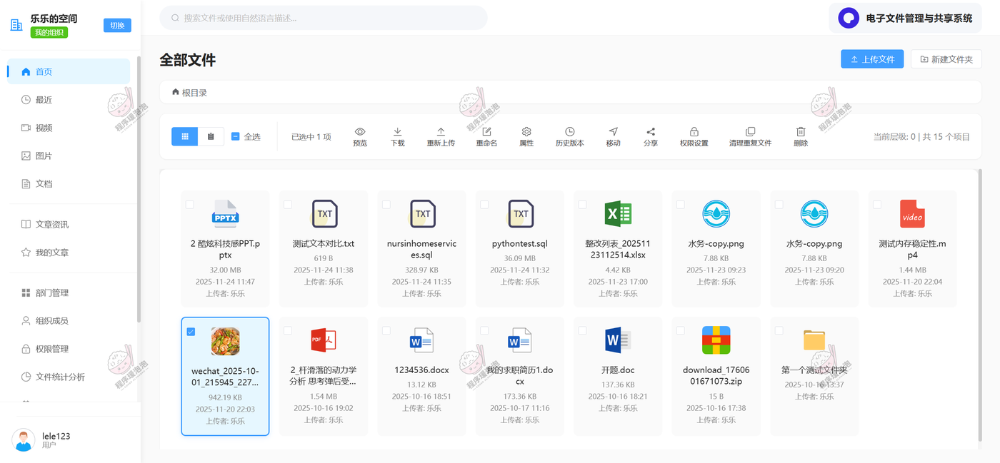

**全部文件（首页）**：网格视图铺出 15 个项目，每张卡显示文件类型图标、文件名、大小、上传时间和上传者。上方工具栏是这套系统的操作总入口——预览、下载、重新上传、重命名、属性、**历史版本**、移动、分享、权限设置、**清理重复文件**、删除，右侧标着当前层级和项目数。选中文件后这些按钮才会亮起。

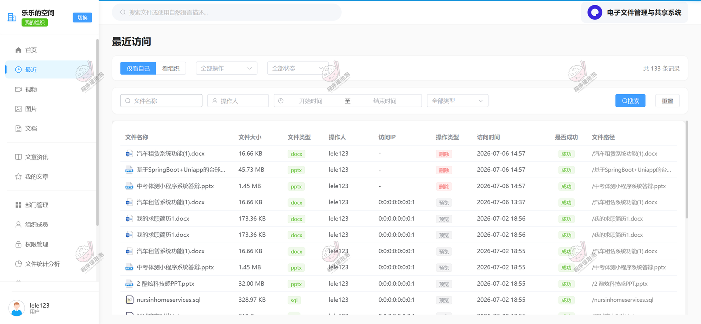

**最近访问**：分「仅看自己」和「看组织」两个视角，共 133 条记录。表格列是文件名称、文件大小、类型、操作人、访问 IP、操作类型（预览 / 删除）、访问时间、是否成功、文件路径，按文件名、操作人、时间区间、类型筛选。这一页既是最近使用记录，也是操作留痕。

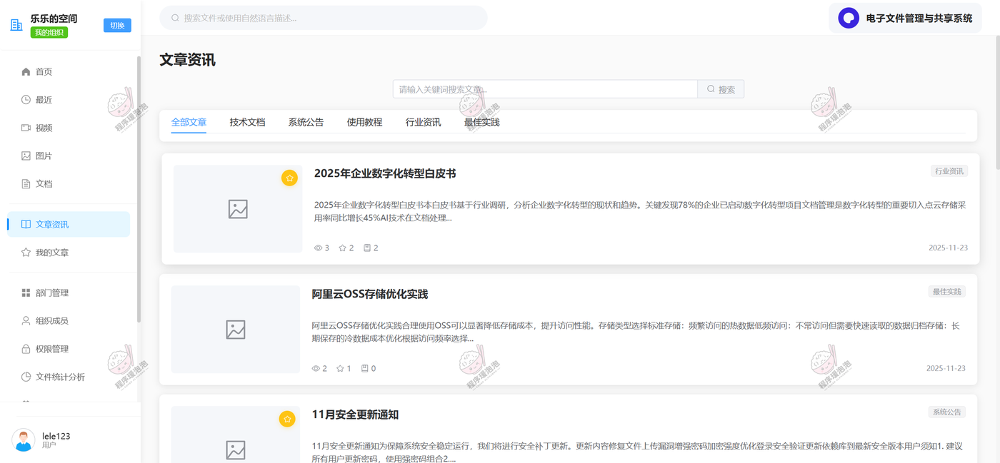

**文章资讯**：按全部文章、技术文档、系统公告、使用教程、行业资讯、最佳实践分类，列表给标题、摘要、浏览 / 点赞 / 评论数、发布日期和分类标签。摘要就是系统抽出来的那段结论，不用点进去判断值不值得读；进入详情后按词频向量推荐同主题文章。

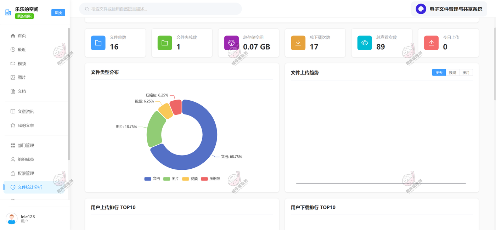

**文件统计分析**：六张指标卡——文件总数 16、文件夹总数 1、总存储空间 0.07GB、总下载 17 次、总查看 89 次、今日上传 0；左侧文件类型分布环图（文档 68.75%、图片 18.75%、视频 6.25%、压缩包 6.25%），右侧上传趋势可切按天 / 按周 / 按月，下方是用户上传排行 TOP10 和下载排行 TOP10。

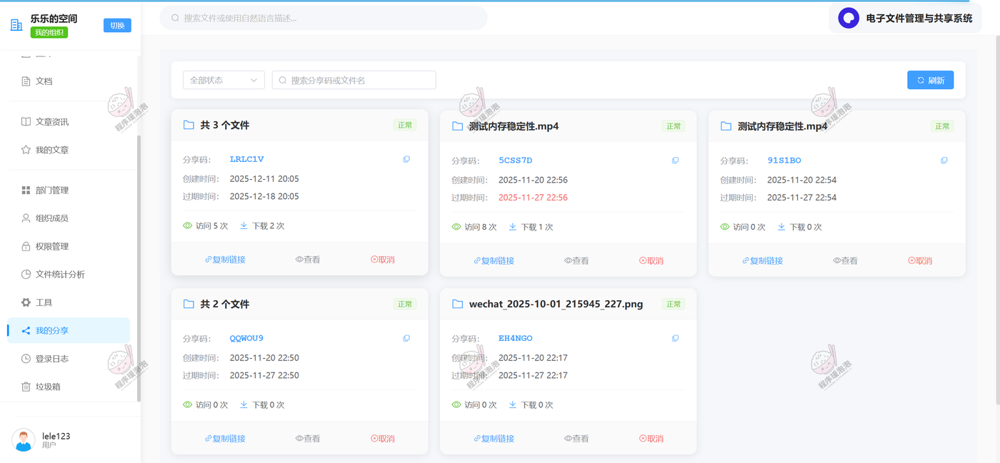

**我的分享**：一个分享一张卡，卡上给分享码（LRLC1V、5CSS7D 等）、创建时间、过期时间、访问次数与下载次数，操作是复制链接、查看、取消。同一张卡可以打包多个文件（「共 3 个文件」），过期后卡片状态从「正常」变成失效，链接自动不可用。

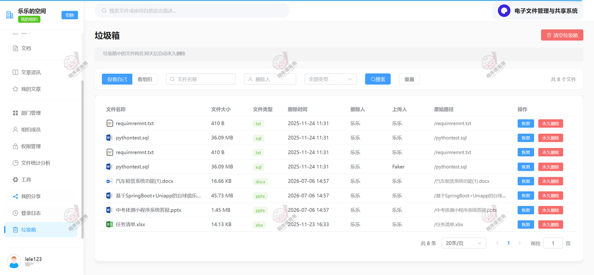

**垃圾箱**：页面顶部写明「垃圾箱中的文件将在 30 天后自动删除」，同样分「仅看自己 / 看组织」。表格记文件名称、大小、类型、删除时间、删除人、上传人和原始路径，可以单条恢复或永久删除，右上角是清空垃圾箱。删错文件还能找回来，也能看出是谁删的。

---

### 组织管理（组织管理员身份）

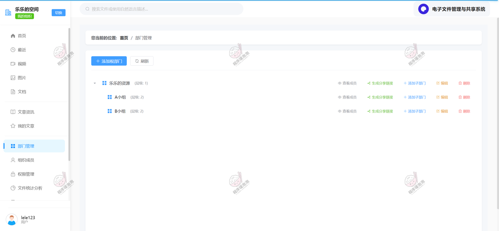

**部门管理**：树形结构维护部门层级，「乐乐的资源」是根（层级 1），下面挂 A 小组、B 小组（层级 2）。每行右侧有查看成员、生成分享链接、添加子部门、编辑、删除五个操作——部门和文件节点一一对应，给部门授权实际就是给这一层的节点授权。

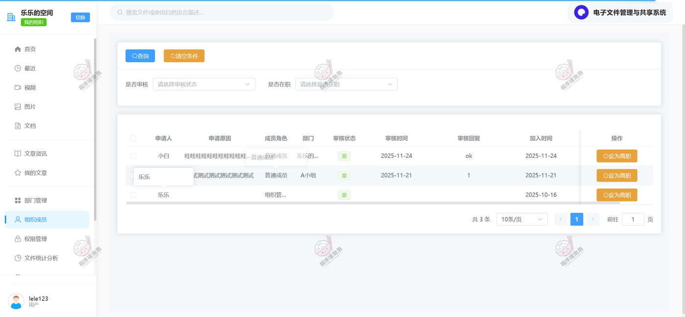

**组织成员**：成员加入要走审核，表格列申请人、申请原因、成员角色（普通成员 / 组织管理员）、部门、审核状态、审核时间、审核回复、加入时间，右侧操作是「设为离职」。申请原因、审核回复都留档，人员进出有据可查。

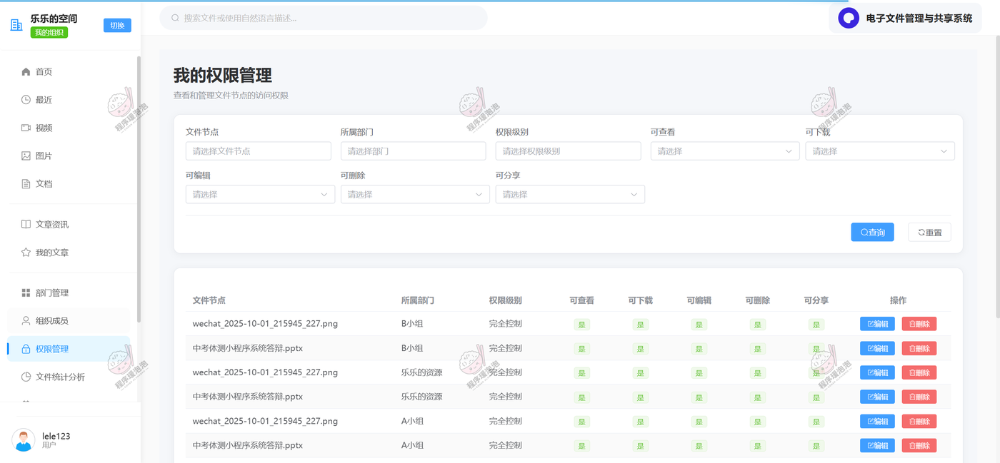

**我的权限管理**：按文件节点、所属部门、权限级别和五项权限逐项筛选，表格一行就是一个节点 × 一个部门的授权记录，权限级别写「完全控制」，后面五列分别标可查看、可下载、可编辑、可删除、可分享是否放行。这一页看的是「谁能对这个节点做什么」。

---

### 管理端

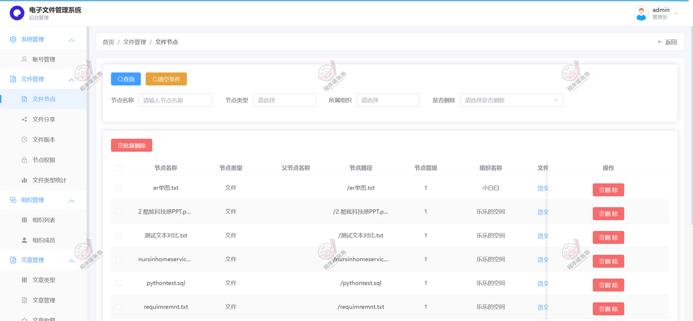

**文件节点**：全平台的文件节点台账，可按节点名称、节点类型、所属组织、是否删除筛选。表格给父节点名称、节点路径（如 `/2 酷炫科技感PPT.pptx`）、节点层级和所属组织，支持勾选批量删除。左侧菜单把系统管理、文件管理、组织管理、文章管理四组功能分得很清楚。

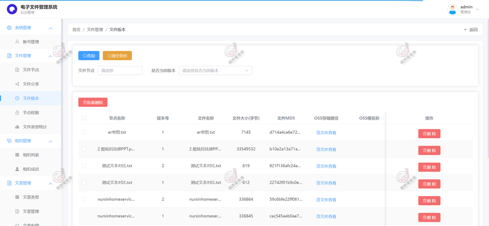

**文件版本**：同一个文件按版本号逐条留痕，表格列节点名称、版本号、文件名称、文件大小（字节）、**文件 MD5**、**OSS 存储路径**、OSS 桶名称和操作。「测试文本对比.txt」V2 是 619 字节、V1 是 612 字节，两版 MD5 不同；「nursinhomeservic...」V2 336864、V1 336845，改动很小也能分出两条。存储落在哪、内容有没有变，这张表都能回答。

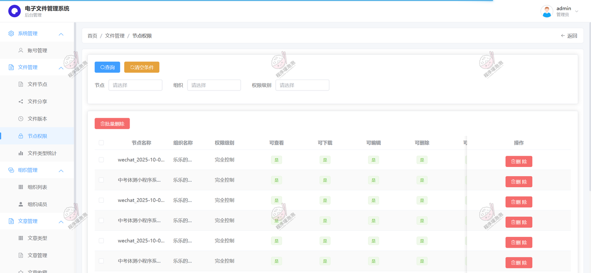

**节点权限**：平台级授权总表，按节点、组织、权限级别筛选。一行对应「节点 × 组织」的一条授权，权限级别「完全控制」，右侧五列是查看 / 下载 / 编辑 / 删除 / 分享的放行标记，支持批量删除。组织管理员在自己那一侧配置的权限，最终都汇总到这里。

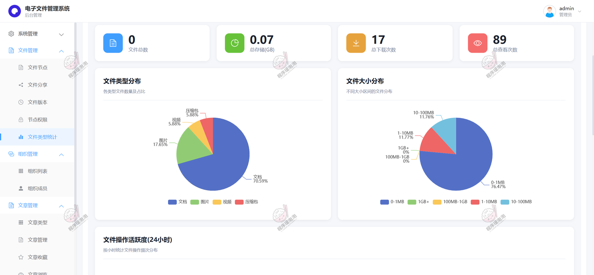

**文件类型统计**：四张指标卡（文件总数、总存储 0.07GB、总下载 17 次、总查看 89 次），下面两张环图分别看类型和体积——文档 70.59%、图片 17.65%、视频 5.88%、压缩包 5.88%；按大小看 0–1MB 占 76.47%、1–10MB 占 11.77%、10–100MB 占 11.76%。底部还有按小时统计的文件操作活跃度。

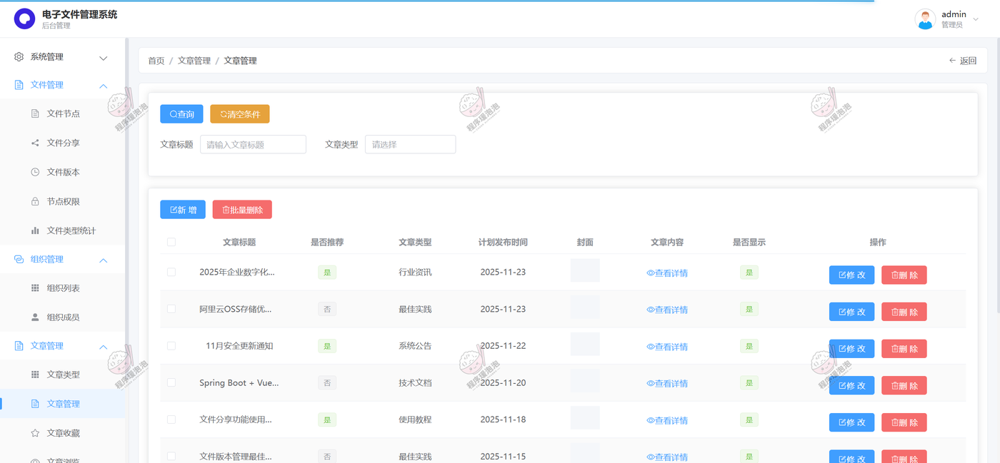

**文章管理**：文章列表带「是否推荐」和「是否显示」两个开关，类型分行业资讯、最佳实践、系统公告、技术文档、使用教程。行操作是修改和删除，内容列点「查看详情」进富文本编辑器。推荐位和上架状态在这一页直接控制，不用另开设置页。

---

### 其余页面

源文档还有视频、图片、文档三个分类浏览页，我的文章、在线工具（PDF 处理、图片压缩、格式转换等六个外链入口）、登录日志，以及管理端的账号管理、文件分享、组织列表、组织成员、文章收藏、登录日志等页面，功能已在角色表中列出，截图未在此逐一展开。

---

> 文档展示 15 张截图，需要了解更多，请联系我。

